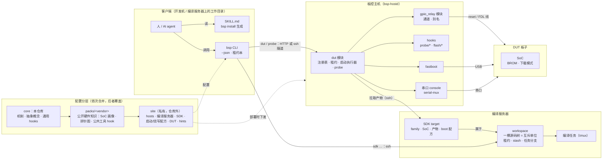
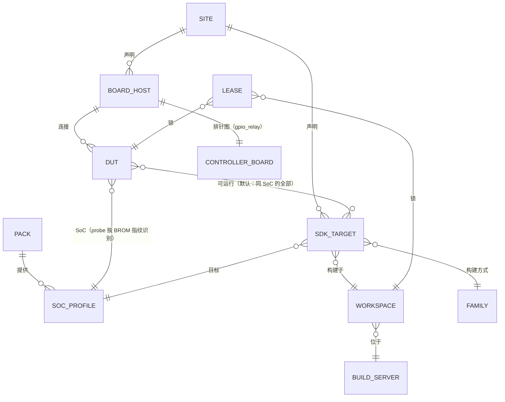

# bsp-dev-loop

面向嵌入式 BSP / 内核 / 引导程序开发者的开发闭环框架：把**板子（DUT）**、**主控机**（reset / FDL 控制线、
fastboot USB 端口映射、串口）和**编译服务器上的 SDK 源码树**统一服务化。每一项能力同时是
**HTTP API**、**CLI 命令**和 **AI tool**，并带状态监控；`bsp` 一个命令人机共用（`--json` 给 agent）。

典型闭环：改 SDK 代码 → 编译服务器编译 → 申请板子 → reset 进下载模式 → fastboot RAM 启动（或烧写）→
串口 `dmesg | grep` 验证 → 提交到任务分支 → 释放。干净的 agent 会话仅凭 `skills/bsp-dev-loop` + `bsp`
即可完成，验收方法见 `e2e-material/`。

本仓库只提供**机制和抽象概念**；任何具体安装的信息（主机、地址、账号、SDK 目录结构、烧写流程、提示）都放在
仓库之外的 **site 配置**里，见下文和 `examples/site/`。

## 架构



概念关系：



| 概念 | 是什么 | 定义在 |
|---|---|---|
| board host | 跑 `bsp-hostd` 的主控机，连着若干 DUT 的控制线、USB、串口 | `<site>/hosts/<id>.yaml`、`<site>/remotes.json` |
| DUT | host + SoC + 控制后端（gpio-relay / manual / …）+ fastboot USB 路径 + 串口 console + 可运行的 SDK | `bsp probe` 注册（host 状态），或 `<site>/duts/` |
| SoC profile | BROM 指纹、下载模式判定、USB VID、身份识别序列 | `packs/*/socs/<soc>/soc.yaml`，site 可覆盖/补充镜像 |
| build server | ssh 可达的编译机，及其任务环境（PATH、变量、家目录别名） | `<site>/sdk/servers/` |
| workspace | 一台服务器上的一棵源码树，**互斥单位**（租约、任务分支、编译锁、任务列表在 `<path>/.bsp/`） | `<site>/sdk/workspaces/`，或每个 target 隐式一个 |
| SDK target | workspace 中的一个构建目标：family、SoC、产物角色、`boot.load` / `boot.download` 配方 | `<site>/sdk/instances/` |
| family | 构建方式（make / envsetup / script）及产物默认值 | `<site>/sdk/families/` |
| hook | 可替换的可执行文件，JSON 输入输出（probe、flash 等） | `hooks/`、`packs/*/hooks/`、`<site>/hooks/` |
| hint | 给 agent/人的自由文本（账号约定、实验室规则…） | `packs/*/hints/`、`<site>/hints/`；`bsp hints` 查看 |
| lease | DUT / workspace 的带 token 租约 | host 状态 / `<path>/.bsp/` |

## 配置分层

| 层 | 内容 | 位置 |
|---|---|---|
| core | 机制与抽象：CLI、hostd 模块、启动执行器、probe 编排、通用 hooks、示例 | 本仓库 |
| packs | 公开硬件知识（像驱动一样）：SoC 画像（BROM 指纹固化在芯片里）、可购买板卡的排针图、公共格式的 hook | `packs/<vendor>/` |
| site | 私有：主机与地址、编译服务器、SDK 目录结构、启动/烧写配方、probe 镜像、DUT、hints | `$BSP_SITE` → `~/.config/bsp/site` → `/etc/bsp/site` |

site 在 `<site>/bsp.yaml` 里用 `packs: [...]` 选择 pack（默认全部）。每层都可以提供 `boards/`、`socs/`、
`hooks/`、`sdk/{families,servers,workspaces,instances}/`、`duts/`、`hints/`，同名者后层覆盖前层。
将来的"发行版"（例如某个 SoC 的上游内核开发闭环、面向上游维护者的发行版）= 一组 pack + 配方模板。
`examples/site/` 是一个完整的虚构 site，演示所有文件格式，测试也基于它。

**不要把任何凭据、地址或站点细节提交到本仓库**：它们属于 site（通常是一个单独的私有 git 仓库）。

## 上手

```bash
# 1. 准备 site：复制 examples/site 并改成你的环境（私有仓库）
cp -r examples/site ~/my-site && export BSP_SITE=~/my-site

# 2. 部署板控主机（需先 commit，或 --allow-dirty）
SSHPASS=<password> deploy/deploy.sh <host-id>                 # 读取 $BSP_SITE/deploy/<host-id>.env
deploy/grant-build-access.sh <host-id> user@build-server      # 允许主机从编译服务器拉取产物

# 3. 客户端（任意装有 python3 的机器）
deploy/install-client.sh user@devbox --site ~/my-site         # 或 clone 本仓库，把 bin/bsp 放进 PATH
cd <SDK 工作目录> && bsp install                               # 生成 ./SKILL.md：完整 skill + 本目录是哪个 SDK + hints
```

已有的 SKILL.md 会先备份为 `SKILL.md.bak.<时间>`。目录未配置为 SDK 时，生成的 SKILL.md 会让 agent 先问用户。

## 端到端

```bash
bsp hosts                                     # 本机是 host 则 local 模式，否则 site 中所有 remote（HTTP 或 ssh 隧道）
bsp probe                                     # 探测板子：GPIO reset ↔ 串口 ↔ USB 关联，BROM 指纹识别 SoC，读身份起名
bsp dut list
bsp sdk acquire <sdk> --task my-fix           # 租用 workspace：stash 原工作区，切到 bsp/my-fix 分支
bsp sdk get/put/exec <sdk> ...                # 远程改代码（或直接在编译服务器上改）
bsp sdk build <sdk> kernel                    # 编译服务器上的后台任务，跟随日志，退出码即结果
bsp dut acquire <dut> --holder me
bsp dut boot <dut> --sdk <sdk>                # 拉取产物 → reset 进下载模式 → 执行 boot 配方 → 等到 shell
bsp dut console <dut> "dmesg | grep my-tag"
bsp dut release <dut>; bsp sdk release <sdk>  # 释放：恢复原分支和 stash，任务分支保留
```

每个 SDK target 声明两种启动方式：`load`（RAM 加载启动，不写介质）和 `download`（烧写后启动）；
未完成的写成 `status: todo` 占位并附说明，`bsp sdk list` 可见。配方步骤：`enter-fdl`、`reset`、`wait`、
`stage`、`continue`、`oem`、`flash`、`getvar`、`settle`、`hook`（详见 `src/bsp/sdk/catalog.py`）。

常用管理：`bsp dut rename OLD NEW [--console]`、`bsp dut set DUT --sdks/--description/--reset-pin ...`、
`bsp dut export`、`bsp dut list --soc <soc> --free`、`bsp dut console DUT`（不带命令则交互 attach）、`bsp hints`。
设计与扩展点见 [docs/architecture.md](docs/architecture.md)，钩子接口见 [hooks/README.md](hooks/README.md)。

## gpio-relay（底层模块）

- Web：`http://<host>:8765` —— 引脚位号图、点选操作、远程 CLI、事件流、API 速查
- CLI（无需安装依赖）：
  ```bash
  bin/bsp -r <host> gpio list
  bin/bsp -r <host> gpio set P7 low            # 原始电平：high | low | input(高阻)
  bin/bsp -r <host> gpio config P11 --mode button
  bin/bsp -r <host> gpio alias add DUT3/reset P11 --owner dut-manager --tags dut3
  bin/bsp -r <host> button click DUT3/reset --ms 300
  bin/bsp -r <host> watch                      # 实时事件
  ```
- curl：
  ```bash
  curl -X POST 'http://<host>:8765/api/v1/gpio/P7/set?level=low'
  curl -X POST http://<host>:8765/api/v1/button/DUT3/reset/click -H 'Content-Type: application/json' -d '{"ms":300}'
  ```
- AI：`GET /llms.txt`、`GET /api/v1/tools?format=anthropic|openai`、`POST /api/v1/tools/<tool_name>`、`/docs`（OpenAPI）。

引脚 target 写法：`33` / `P33` / `J40:33`（物理脚位）、`GPIO127`（Linux GPIO 号）、或别名（`DUT3/reset`）。

### 通道模式

| 模式 | 动作 | 语义 |
|---|---|---|
| `gpio` | high / low / input / pulse / free | 原始电平 |
| `relay` | on / off / toggle / pulse | 开关语义，可配 `active_low`、`drive`（push_pull / open_drain） |
| `button` | press / release / click | relay 预设：active_low + open_drain。按下=拉低到 GND，松开=高阻，不会把 3.3V 灌进 DUT 低压网络 |

Web/API 修改的通道配置存为运行时覆盖（`<state_dir>/gpio_relay/channels.json`）；
`bsp gpio export` 输出合并后的 channels + aliases YAML，贴进 `<site>/hosts/<host>.yaml` 即成为基线。

### 别名

每个组件只维护自己的别名表、只负责 resolve；含义由下游注册。例如 dut 模块向 gpio-relay 注册
`<dut>/reset → P11`，之后 `bsp dut reset <dut>` 原样透传为 `button click <dut>/reset`。层级路径、大小写不敏感，
重复注册同一映射幂等，改指向需 `replace`；host 配置里的 `aliases:` 是只读基线。

## 多主机 CLI

`bsp` 一个客户端对接多台 host：清单来自 `<site>/remotes.json`，个人覆盖写在 `~/.config/bsp/remotes.json`。

```bash
bsp remote list                         # 所有实例 + 在线状态 / 实际走的地址
bsp -r <prefix> gpio list               # 名字前缀即可；-r 可放在命令行任意位置
bsp -r a,b status                       # 多实例并发，输出带 [实例名] 前缀
bsp --stateless -r a button click DUT3/reset   # agent / 并行任务：不读默认值，必须显式指定
bsp remote add lab http://x:8765 --fallback http://y:8765
```

选择优先级：`--url` > `-r` > `$BSP_URL` > `$BSP_REMOTE` > `bsp remote use` 保存的默认值。每个实例可配
`fallback_urls` 和 `ssh`（HTTP 不通时经 ssh 隧道访问）。

## 错误即诊断

所有错误都是 `{ok:false, error:{code, message, hint, details}}`：`hint` 给出下一步（did-you-mean、谁持有租约、
该跑什么命令），`details` 给机器可读的上下文。退出码：0 成功，1 命令失败，2 用法错误，3 实例不可达。

## 开发

```bash
uv venv .venv && uv pip install -p .venv -e '.[server,dev]'
.venv/bin/pytest                                                     # 基于 examples/site
BSP_SITE=examples/site .venv/bin/bsp-hostd -c examples/site/hosts/dev-mock.yaml   # http://127.0.0.1:8765，mock 后端
```

部署内容：git 跟踪文件 → `<INSTALL_DIR>/app`，site → `<INSTALL_DIR>/site`，venv → `<INSTALL_DIR>/venv`，
systemd `bsp-hostd.service`，串口 console 为 `bsp-console-<alias>` 单元；主机在 NAT 后时可选 UPnP 映射 `bsp-upnp.timer`。
