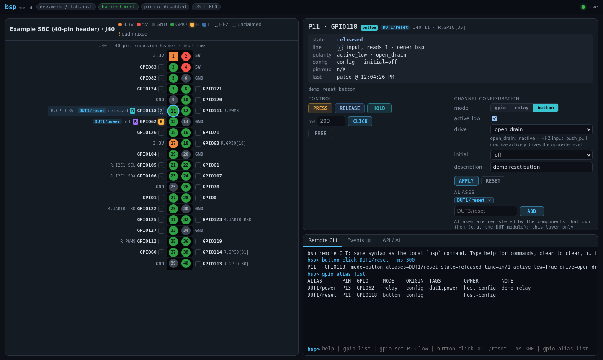
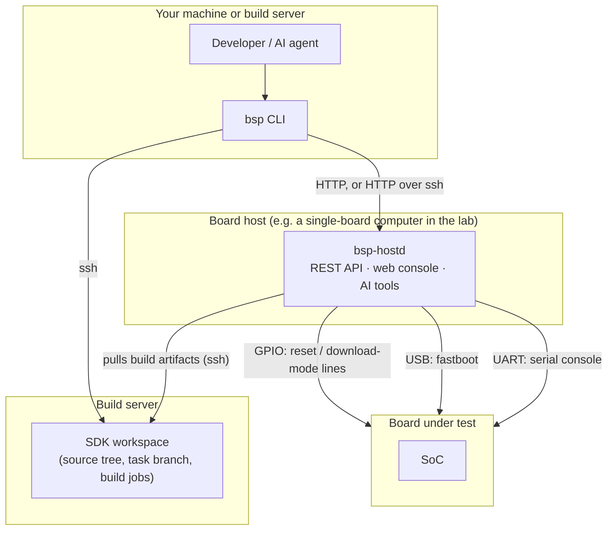

# bsp-dev-loop

[](https://github.com/rzbdz/remote-embedded-ai-workflow/actions/workflows/ci.yml)
[](LICENSE)


English | [简体中文](README.zh-CN.md)

**Edit, build, boot and verify embedded Linux on real boards — from one command line that
people and AI agents share.**

`bsp` turns a lab of development boards into a shared, scriptable service. You lease a board,
build your kernel or bootloader on a remote build server, RAM-boot or flash it over fastboot,
and check the result on the serial console — without logging in to the build server, touching
GPIO lines or juggling `fastboot -s` and serial ports by hand.

It is built for BSP, kernel and bootloader developers, and for the AI coding agents working
next to them: every operation is a single command with machine-readable output and an
actionable error message, also reachable over HTTP and as an AI tool.



## Contents

- [Features](#features)
- [The loop at a glance](#the-loop-at-a-glance)
- [How it works](#how-it-works)
- [Supported hardware](#supported-hardware)
- [Try it without hardware](#try-it-without-hardware)
- [Requirements](#requirements)
- [Installation](#installation)
- [Using bsp with AI agents](#using-bsp-with-ai-agents)
- [Interfaces](#interfaces)
- [Configuration](#configuration)
- [Security](#security)
- [Documentation](#documentation)
- [Project status](#project-status)
- [Contributing](#contributing)
- [License](#license)

## Features

- **Board leases.** Boards (DUTs, devices under test) are leased with a token, so people,
  CI jobs and agents can share one lab without stepping on each other.
- **Remote SDK workspaces.** Leasing an SDK source tree on a build server parks the owner's
  uncommitted changes and checks out a task branch; releasing restores both. Builds run as
  detached jobs that survive a dropped connection.
- **Boot recipes.** Each SDK target declares how to RAM-boot (`load`) and how to flash
  (`download`) as a short list of steps — reset into download mode, stage, continue, flash,
  wait for a console pattern — or calls a hook for vendor flash tools.
- **Board discovery.** `bsp probe` finds which GPIO line resets which board, which serial
  console and USB port belong to it, identifies the SoC from its boot-ROM output and proposes a
  name.
- **Reset and power control.** GPIO header lines act as open-drain "buttons" or relays, with
  aliases such as `board-1/reset`, a web pin map and pin-conflict checks.
- **Serial consoles.** Persistent, logged consoles that survive USB-UART re-enumeration, via
  [serial-mux](https://github.com/TroyMitchell911/serial-mux) (a submodule: our fork with
  USB-port-following reconnects). Run a command and get its output, attach interactively, or
  let people open a board's console with `ssh bsp-<board>@<host>` (optional).
- **Boards without wiring.** `bsp dut bind` turns a serial console and a USB port into a board
  slot in seconds. When it needs a reset, bsp asks a person and continues once they confirm or
  once the board shows up in download mode — useful for batch flashing and quick bring-up.
- **Many hosts, one CLI.** The client finds every board host it knows about, over HTTP or
  tunnelled through ssh, and routes each command to the host that owns the board.
- **Agent-ready.** `--json` everywhere, an error envelope with a `hint` for the next step,
  `--stateless` mode for parallel agents, a ready-made agent skill and `bsp install` to drop it
  into an SDK tree.
- **Configuration stays yours.** Hosts, build servers, SDK layouts and recipes live in a
  separate *site* directory; the repository contains no installation-specific data.

## The loop at a glance

```console
$ bsp dut list --free
DUT            HOST   SOC    BOARD    STAGE    LEASE  USB        CONSOLE        SDKS
example-board  lab-1  soc-b  board-x  off-bus  free   usb:1-1.2  example-board  upstream-a

$ bsp sdk acquire upstream-a --task fix-usb-resume      # lease the tree, branch bsp/fix-usb-resume
$ bsp sdk get upstream-a drivers/usb/core/hub.c -o hub.c    # edit remotely: fetch, change, write back
$ vi hub.c && bsp sdk put upstream-a drivers/usb/core/hub.c hub.c
$ bsp sdk build upstream-a kernel                       # runs on the build server, streams the log
$ bsp dut acquire example-board
$ bsp dut boot example-board --sdk upstream-a           # RAM boot; --method download flashes instead
  [   1.5s] reset: pulse example-board/reset (P33) active for 1000 ms
  [   3.6s] board in download mode on usb:1-1.2
  [   3.8s] step 2/10 stage: staged fsbl (201,856 B) in 0.2s
  ...
  [  44.3s] done in 42.8s
$ bsp dut console example-board "dmesg | grep -i usb"
$ bsp sdk exec upstream-a -- git commit -am "'usb: fix resume'"   # inner quotes survive the remote shell
$ bsp dut release example-board && bsp sdk release upstream-a
```

When something goes wrong, the error says what to do next:

```console
$ bsp dut acquire example-bord
error[not_found]: no DUT 'example-bord' on any reachable host
hint: did you mean: example-board? known: example-board@lab-1
```

## How it works



- **Board host** — a Linux machine wired to the boards: GPIO lines to their reset (and
  optionally download-mode) buttons, USB for fastboot, USB-UART adapters for the consoles. It
  runs `bsp-hostd`, which owns the boards, their leases and the boot recipes.
- **Build server** — where SDK source trees live and build. bsp needs only ssh and Python ≥ 3.6
  there; nothing is installed.
- **Client** — the `bsp` command on a workstation or on the build server itself.

Installation-specific knowledge comes from configuration layers: the generic core, optional
hardware **packs** shipped in this repository (public facts such as SoC boot-ROM signatures and
board pinouts) and your private **site** directory. See
[docs/architecture.md](docs/architecture.md) for the full model.

## Supported hardware

| Component | Supported | Notes |
|---|---|---|
| Boards (DUTs) | SoCs whose boot ROM offers a USB download mode reachable with `fastboot` | Boot steps are configuration, so other flows can be described without code |
| SoC profiles shipped | SpacemiT K1, SpacemiT K3 (`packs/spacemit`) | Boards tested as DUTs: K1-x MUSE Card (K1), K3 deb1 (K3) |
| Board hosts | Linux with a GPIO header (sysfs or libgpiod), USB host ports, systemd | Header pin maps shipped for two SpacemiT boards used as hosts: K3 Com260 and K1-x deb1; add yours as a YAML file |
| Reset control | GPIO open-drain button or relay; a person, prompted by bsp (`human`) | A Home Assistant backend is a stub |
| Consoles | Any USB-UART adapter, via serial-mux | |

Adding a SoC is a YAML profile plus, optionally, a known-good bootloader image; see
[docs/porting.md](docs/porting.md).

## Try it without hardware

The repository ships a fictional site (`examples/site/`) and a mock GPIO backend, so you can
explore the CLI, the HTTP API and the web console on any Linux machine:

```bash
git clone --recurse-submodules https://github.com/rzbdz/remote-embedded-ai-workflow.git bsp-dev-loop
cd bsp-dev-loop
python3 -m venv .venv && .venv/bin/pip install -e '.[server]'

export BSP_SITE=$PWD/examples/site
.venv/bin/bsp-hostd -c examples/site/hosts/dev-mock.yaml --port 8765 &

export BSP_URL=http://127.0.0.1:8765
bin/bsp dut list                      # two mock boards: mock-board (GPIO reset), mock-slot (manual reset)
bin/bsp button click DUT1/reset       # "press" a reset button on the mock GPIO header
bin/bsp sdk list                      # the example SDK catalog
bin/bsp sdk plan bsp-a --boot load    # what a RAM boot of bsp-a would do
```

Then open <http://127.0.0.1:8765> for the web console. The mock boards can be leased and reset
with `bsp dut reset mock-board --no-fdl`; download mode and booting need real hardware.

## Requirements

| Role | Needs |
|---|---|
| Client | Python ≥ 3.8 and PyYAML (run `bin/bsp` from a clone), or Python ≥ 3.10 for `pip install`; `ssh` |
| Board host | Linux, Python ≥ 3.10, systemd, root access, `fastboot`, GPIO via sysfs or libgpiod (plus the `libgpiod` system library for the latter), network access to PyPI during installation |
| Build server | ssh access with a key, Python ≥ 3.6, git; `tmux` recommended |
| Machine that deploys hosts | git, ssh, tar (and `sshpass` only for password logins) |

## Installation

Clone with submodules (serial-mux, which provides the consoles, is a submodule):

```bash
git clone --recurse-submodules https://github.com/rzbdz/remote-embedded-ai-workflow.git bsp-dev-loop
```

Then, in short:

1. **Create a site.** Copy `examples/site/` to a private location (for example its own git
   repository) and describe your board hosts, build servers and SDKs. Point `BSP_SITE` at it,
   or place it at `~/.config/bsp/site`.
2. **Deploy each board host:** `deploy/deploy.sh HOST_ID` installs `bsp-hostd` as a systemd
   service, using `SITE/deploy/HOST_ID.env` and `SITE/hosts/HOST_ID.yaml`.
3. **Install the client** where you work: `deploy/install-client.sh USER@MACHINE --site SITE_DIR`,
   or add `bin/` of a clone to your `PATH`.
4. **Check and discover:** `bsp init` shows which hosts are reachable; `bsp probe --dry-run`
   lists reset-line and console candidates, and `bsp probe` registers the boards it finds.

[docs/getting-started.md](docs/getting-started.md) walks through each step, including the
minimum site you need and how to probe safely.

## Using bsp with AI agents

bsp is designed so an agent needs nothing but the CLI:

- `deploy/install-skills.sh` installs the bundled skills (`skills/bsp-dev-loop`,
  `skills/bsp-gpio-relay`) for Claude Code, opencode and Hermes.
- `bsp install`, run inside an SDK tree, writes a `SKILL.md` that adds what this directory
  is, which boards can run it and your site's hints to the full skill.
- `--json` gives `{"ok": true, "result": …}` or `{"ok": false, "error": {"code", "message",
  "hint", "details"}}`; `--stateless` with explicit lease tokens lets agents run in parallel.
- Each board host serves `/llms.txt` and tool schemas in Anthropic and OpenAI formats at
  `/api/v1/tools`.

`e2e-material/` contains the acceptance test: a fresh agent session with only the skill must
change a kernel, build it, boot it on a free board and prove the change from `dmesg`. See
[docs/agents.md](docs/agents.md).

## Interfaces

| Capability | CLI | HTTP API / web | AI tools |
|---|---|---|---|
| GPIO, relays, buttons, aliases | `bsp gpio`, `relay`, `button` | yes | yes |
| Boards: list, lease, reset, boot, console, probe | `bsp dut`, `bsp probe` | yes | yes |
| SDK catalog and boot plans | `bsp sdk list`, `show`, `plan` | yes | yes |
| SDK leases, builds, remote edits | `bsp sdk acquire`, `build`, `exec`, `get`, `put`, `release` | — (client-side over ssh) | via the CLI |
| Events | `bsp watch` | Server-Sent Events | — |

The web console currently covers the GPIO header (pin map, inspector, events, API reference)
and a remote CLI that accepts every host command.

## Configuration

| Layer | Contents | Location |
|---|---|---|
| Core | Mechanisms, generic hooks, examples | this repository |
| Packs | Public hardware knowledge: SoC profiles, board pin maps, hooks for public tool formats | `packs/` in this repository |
| Site | Your hosts, build servers, SDK trees, boot and flash recipes, boards, hints | `$BSP_SITE`, `~/.config/bsp/site` or `/etc/bsp/site` |

Later layers override earlier ones file by file. Start from `examples/site/`; every format is
documented in [docs/configuration.md](docs/configuration.md) and
[docs/sdk.md](docs/sdk.md).

## Security

A board host can reset and flash hardware, so treat its API like ssh access:

- `bsp-hostd` listens on `127.0.0.1` unless the host configuration sets `server.bind`.
- Set a token before exposing it on a network (`BSP_TOKEN` in `/etc/bsp/hostd.env` on the
  host); clients pass it with `--token`, `BSP_TOKEN` or `bsp remote add … --token`. Read-only
  requests, including console output, stay open.
- Never publish a board host to the internet.
- Prefer ssh keys for deployment and build-server access.

See [SECURITY.md](SECURITY.md) for the threat model and how to report vulnerabilities.

## Documentation

| Document | Covers |
|---|---|
| [Getting started](docs/getting-started.md) | Site setup, deployment, first probe, first boot |
| [Configuration](docs/configuration.md) | Layers, site layout, host config, host selection, environment variables |
| [SDKs and boot recipes](docs/sdk.md) | Build servers, workspaces, SDK targets, recipe steps, leases on source trees |
| [CLI reference](docs/cli.md) | Commands, global options, output format, exit codes |
| [GPIO relay](docs/gpio-relay.md) | Channel modes, pin addressing, aliases, wiring |
| [Deployment](docs/deployment.md) | `deploy.sh`, host layout, services, client installation |
| [AI agents](docs/agents.md) | Skills, `bsp install`, parallel agents, acceptance test |
| [Porting](docs/porting.md) | New SoCs, board hosts, packs and hooks |
| [Architecture](docs/architecture.md) | Concepts, layers, extension points |
| [Hooks](hooks/README.md) | The hook contract |

## Project status

bsp is **beta** (0.1). The full loop — lease, build, RAM boot, flash and console check — is in
daily use on SpacemiT K1 and K3 boards, and the test suite runs without hardware. Command names
and the `/api/v1` HTTP API may still change before 1.0; changes are recorded in
[CHANGELOG.md](CHANGELOG.md).

Planned: an MCP server, DUT and SDK views in the web console, more SoC packs, and reusable
recipe templates for common SDK layouts.

## Contributing

Bug reports, SoC packs and fixes are welcome. Read [CONTRIBUTING.md](CONTRIBUTING.md) for the
development setup (`pip install -e '.[server,dev]' && pytest`; no hardware needed) and for what
belongs in a pack versus a site.

## License

Apache License 2.0 — see [LICENSE](LICENSE). The serial-mux submodule (a fork of
[TroyMitchell911/serial-mux](https://github.com/TroyMitchell911/serial-mux)) is distributed under
its own license.
