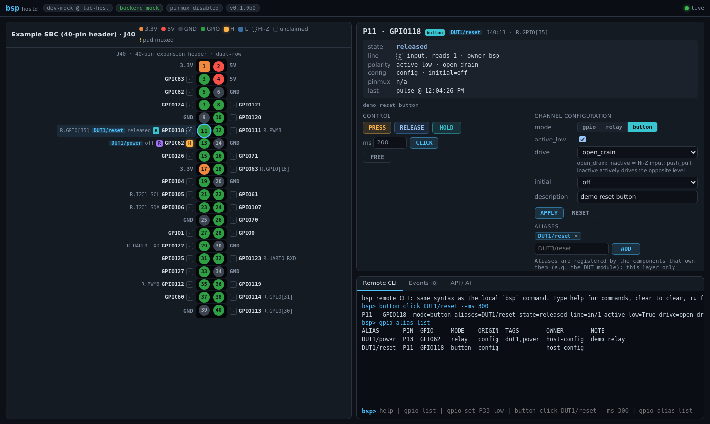
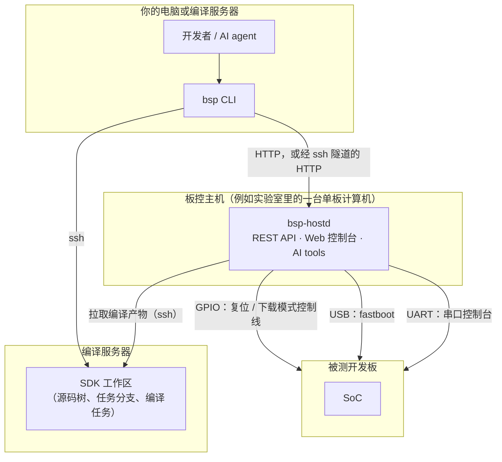

# bsp-dev-loop

[](https://github.com/rzbdz/remote-embedded-ai-workflow/actions/workflows/ci.yml)
[](LICENSE)


[English](README.md) | 简体中文

**在真实开发板上修改、编译、启动并验证嵌入式 Linux——人和 AI agent 共用同一个命令行。**

`bsp` 把一屋子开发板变成可共享、可编程调用的服务：租用一块板子，在远程编译服务器上编译内核或
引导程序，通过 fastboot 加载到内存启动或烧写，再在串口上检查结果。全程无需登录编译服务器，
无需手动操作 GPIO，也无需自己管理 `fastboot -s` 和串口设备。

它面向 BSP、内核和引导程序开发者，以及与他们协作的 AI 编程 agent：每个操作都是一条命令，输出可被
程序解析，出错时会给出可执行的下一步建议；同样的能力也以 HTTP API 和 AI tool 的形式提供。



## 目录

- [功能](#功能)
- [一个完整的开发闭环](#一个完整的开发闭环)
- [工作原理](#工作原理)
- [支持的硬件](#支持的硬件)
- [无硬件试用](#无硬件试用)
- [环境要求](#环境要求)
- [安装](#安装)
- [与 AI agent 配合使用](#与-ai-agent-配合使用)
- [接口](#接口)
- [配置](#配置)
- [安全](#安全)
- [文档](#文档)
- [项目状态](#项目状态)
- [参与贡献](#参与贡献)
- [许可证](#许可证)

## 功能

- **板子租约。** 开发板（DUT，被测设备）通过带令牌的租约分配，开发者、CI 任务和 agent 可以共享同一个
  实验室而互不干扰。
- **远程 SDK 工作区。** 租用编译服务器上的 SDK 源码树时，所有者未提交的修改会被暂存，并切换到任务分支；
  释放时两者都会恢复。编译以后台任务运行，连接断开也不受影响。
- **启动配方。** 每个 SDK target 用一小串步骤声明如何加载到内存启动（`load`）和如何烧写（`download`）：
  复位进入下载模式、stage、continue、flash、等待串口输出；也可以调用 hook 执行厂商烧写工具。
- **板子发现。** `bsp probe` 自动找出哪根 GPIO 线复位哪块板子、它对应哪个串口和 USB 端口，根据 BootROM
  输出识别 SoC，并给出命名建议。
- **复位与电源控制。** 排针 GPIO 可作为开漏"按键"或继电器使用，支持 `board-1/reset` 这样的别名、
  网页引脚图和引脚复用冲突检查。
- **串口控制台。** 常驻、带日志的控制台，USB 转串口重新枚举后仍可继续使用。基于
  [serial-mux](https://github.com/TroyMitchell911/serial-mux)（以子模块形式包含：我们的分支，增加了按 USB
  端口自动重连，分支 `bsp/usb-port-reconnect`）。可以执行单条命令取回输出、交互式接入，也可以（可选）让人
  直接用 `ssh bsp-<板名>@<主机>` 打开某块板子的串口。
- **免接线的板子。** `bsp dut bind` 只用一个串口和一个 USB 端口即可登记一块板子。需要复位时，bsp 会请人
  按复位键，在对方确认或检测到板子进入下载模式后自动继续，适合批量烧写和快速联调。
- **多主机，一个 CLI。** 客户端会找到所有已知的板控主机（直接 HTTP 或经 ssh 隧道），并把每条命令路由到
  板子所在的主机。
- **为 agent 而设计。** 所有命令支持 `--json`，错误中带有指明下一步的 `hint`，`--stateless` 模式便于多个
  agent 并行；仓库自带 agent skill，`bsp install` 可将其放入 SDK 源码树。
- **配置归你所有。** 主机、编译服务器、SDK 目录结构和配方都放在独立的 *site* 目录中，仓库本身不含任何
  具体环境的数据。

## 一个完整的开发闭环

```console
$ bsp dut list --free
DUT            HOST   SOC    BOARD    STAGE    LEASE  USB        CONSOLE        SDKS
example-board  lab-1  soc-b  board-x  off-bus  free   usb:1-1.2  example-board  upstream-a

$ bsp sdk acquire upstream-a --task fix-usb-resume      # 租用源码树，切到分支 bsp/fix-usb-resume
$ bsp sdk get upstream-a drivers/usb/core/hub.c -o hub.c    # 远程修改：取回、修改、写回
$ vi hub.c && bsp sdk put upstream-a drivers/usb/core/hub.c hub.c
$ bsp sdk build upstream-a kernel                       # 在编译服务器上编译，实时输出日志
$ bsp dut acquire example-board
$ bsp dut boot example-board --sdk upstream-a           # 内存启动；--method download 则为烧写
  [   1.5s] reset: pulse example-board/reset (P33) active for 1000 ms
  [   3.6s] board in download mode on usb:1-1.2
  [   3.8s] step 2/10 stage: staged fsbl (201,856 B) in 0.2s
  ...
  [  44.3s] done in 42.8s
$ bsp dut console example-board "dmesg | grep -i usb"
$ bsp sdk exec upstream-a -- git commit -am "'usb: fix resume'"   # 内层引号用于远程 shell
$ bsp dut release example-board && bsp sdk release upstream-a
```

出错时，错误信息会说明下一步该做什么：

```console
$ bsp dut acquire example-bord
error[not_found]: no DUT 'example-bord' on any reachable host
hint: did you mean: example-board? known: example-board@lab-1
```

## 工作原理



- **板控主机**：与开发板连线的 Linux 机器——GPIO 接到板子的复位键（以及可选的下载模式键），USB 用于
  fastboot，USB 转串口用于控制台。它运行 `bsp-hostd`，负责管理板子、租约和启动配方。
- **编译服务器**：存放并编译 SDK 源码树的机器。只需要 ssh 和 Python ≥ 3.6，无需安装任何东西。
- **客户端**：工作站或编译服务器上的 `bsp` 命令。

具体环境的知识来自分层配置：通用的核心、仓库自带的可选硬件 **pack**（SoC BootROM 特征、板卡排针定义等
公开信息），以及你私有的 **site** 目录。完整模型见 [docs/architecture.md](docs/architecture.md)。

## 支持的硬件

| 组件 | 支持范围 | 说明 |
|---|---|---|
| 开发板（DUT） | BootROM 提供可用 `fastboot` 访问的 USB 下载模式的 SoC | 启动步骤是配置，其他流程无需写代码即可描述 |
| 自带的 SoC 配置 | SpacemiT K1、SpacemiT K3（`packs/spacemit`） | 已验证的被测板：K1-x MUSE Card（K1）、K3 deb1（K3） |
| 板控主机 | 带 GPIO 排针（sysfs 或 libgpiod）、USB 主机口和 systemd 的 Linux | 自带两款用作板控主机的 SpacemiT 板卡的排针定义：K3 Com260 和 K1-x deb1；其他主机加一个 YAML 文件即可 |
| 复位控制 | GPIO 开漏按键或继电器；由 bsp 提示人工操作（`human`） | Home Assistant 后端尚为占位实现 |
| 控制台 | 任意 USB 转串口，经由 serial-mux | |

新增 SoC 只需一个 YAML 配置，以及可选的已知可用的引导程序镜像，见 [docs/porting.md](docs/porting.md)。

## 无硬件试用

仓库自带一个虚构的 site（`examples/site/`）和模拟 GPIO 后端，可以在任意 Linux 机器上体验 CLI、HTTP API
和 Web 控制台：

```bash
git clone --recurse-submodules https://github.com/rzbdz/remote-embedded-ai-workflow.git bsp-dev-loop
cd bsp-dev-loop
python3 -m venv .venv && .venv/bin/pip install -e '.[server]'

export BSP_SITE=$PWD/examples/site
.venv/bin/bsp-hostd -c examples/site/hosts/dev-mock.yaml --port 8765 &

export BSP_URL=http://127.0.0.1:8765
bin/bsp dut list                      # 两块模拟板子：mock-board（GPIO 复位）、mock-slot（人工复位）
bin/bsp button click DUT1/reset       # 在模拟排针上"按下"复位键
bin/bsp sdk list                      # 示例 SDK 目录
bin/bsp sdk plan bsp-a --boot load    # bsp-a 内存启动会执行的步骤
```

然后打开 <http://127.0.0.1:8765> 查看 Web 控制台。模拟板子可以租用，并用 `bsp dut reset mock-board --no-fdl`
复位；进入下载模式和启动需要真实硬件。

## 环境要求

| 角色 | 需要 |
|---|---|
| 客户端 | Python ≥ 3.8 和 PyYAML（从源码目录运行 `bin/bsp`），或 Python ≥ 3.10（`pip install`）；`ssh` |
| 板控主机 | Linux、Python ≥ 3.10、systemd、root 权限、`fastboot`、sysfs 或 libgpiod 形式的 GPIO（后者还需系统库 `libgpiod`），安装时可访问 PyPI |
| 编译服务器 | 基于密钥的 ssh 访问、Python ≥ 3.6、git；建议安装 `tmux` |
| 执行部署的机器 | git、ssh、tar（仅密码登录时需要 `sshpass`） |

## 安装

带子模块克隆（提供串口控制台的 serial-mux 是子模块）：

```bash
git clone --recurse-submodules https://github.com/rzbdz/remote-embedded-ai-workflow.git bsp-dev-loop
```

接下来简要步骤如下：

1. **创建 site。** 把 `examples/site/` 复制到私有位置（例如单独的 git 仓库），描述你的板控主机、编译服务器
   和 SDK。用 `BSP_SITE` 指向它，或放在 `~/.config/bsp/site`。
2. **部署每台板控主机：** `deploy/deploy.sh HOST_ID` 根据 `SITE/deploy/HOST_ID.env` 和
   `SITE/hosts/HOST_ID.yaml` 把 `bsp-hostd` 安装为 systemd 服务。
3. **在工作的机器上安装客户端：** `deploy/install-client.sh USER@MACHINE --site SITE_DIR`，或把源码目录的
   `bin/` 加入 `PATH`。
4. **检查并发现板子：** `bsp init` 显示可达的主机；`bsp probe --dry-run` 列出候选的复位线和串口，
   `bsp probe` 登记找到的板子。

[docs/getting-started.md](docs/getting-started.md) 逐步介绍每个环节，包括最小 site 配置和安全地进行 probe。

## 与 AI agent 配合使用

bsp 的设计目标是让 agent 只靠 CLI 就能完成全部工作：

- `deploy/install-skills.sh` 为 Claude Code、opencode 和 Hermes 安装自带的 skill（`skills/bsp-dev-loop`、
  `skills/bsp-gpio-relay`）。
- 在 SDK 源码树中运行 `bsp install` 生成 `SKILL.md`：在完整 skill 的基础上，补充说明本目录是哪个 SDK、
  哪些板子能运行它，以及 site 中的提示。
- `--json` 输出 `{"ok": true, "result": …}` 或 `{"ok": false, "error": {"code", "message", "hint",
  "details"}}`；`--stateless` 配合显式的租约令牌可让多个 agent 并行工作。
- 每台板控主机提供 `/llms.txt`，并在 `/api/v1/tools` 提供 Anthropic 和 OpenAI 格式的 tool 定义。

`e2e-material/` 是验收测试：一个只拿到 skill 的全新 agent 会话，必须修改内核、编译、在空闲板子上启动，
并通过 `dmesg` 证明修改生效。详见 [docs/agents.md](docs/agents.md)。

## 接口

| 能力 | CLI | HTTP API / Web | AI tools |
|---|---|---|---|
| GPIO、继电器、按键、别名 | `bsp gpio`、`relay`、`button` | 支持 | 支持 |
| 板子：列表、租约、复位、启动、控制台、发现 | `bsp dut`、`bsp probe` | 支持 | 支持 |
| SDK 目录与启动计划 | `bsp sdk list`、`show`、`plan` | 支持 | 支持 |
| SDK 租约、编译、远程编辑 | `bsp sdk acquire`、`build`、`exec`、`get`、`put`、`release` | —（客户端经 ssh 执行） | 通过 CLI |
| 事件 | `bsp watch` | Server-Sent Events | — |

Web 控制台目前覆盖 GPIO 排针（引脚图、引脚详情、事件、API 参考）以及可执行所有主机命令的远程 CLI。

## 配置

| 层 | 内容 | 位置 |
|---|---|---|
| 核心 | 机制、通用 hook、示例 | 本仓库 |
| Pack | 公开的硬件知识：SoC 配置、板卡引脚定义、公开格式的 hook | 本仓库 `packs/` |
| Site | 你的主机、编译服务器、SDK 源码树、启动与烧写配方、板子、提示 | `$BSP_SITE`、`~/.config/bsp/site` 或 `/etc/bsp/site` |

后面的层按文件覆盖前面的层。从 `examples/site/` 开始；所有格式见 [docs/configuration.md](docs/configuration.md)
和 [docs/sdk.md](docs/sdk.md)。

## 安全

板控主机可以复位和烧写硬件，应像对待 ssh 权限一样对待它的 API：

- 除非主机配置设置了 `server.bind`，`bsp-hostd` 只监听 `127.0.0.1`。
- 在网络上开放之前设置令牌（主机上 `/etc/bsp/hostd.env` 中的 `BSP_TOKEN`）；客户端通过 `--token`、
  `BSP_TOKEN` 或 `bsp remote add … --token` 传入。只读请求（包括串口输出）保持开放。
- 不要把板控主机暴露到公网。
- 部署和访问编译服务器优先使用 ssh 密钥。

威胁模型和漏洞报告方式见 [SECURITY.md](SECURITY.md)。

## 文档

以下文档目前仅有英文版：

| 文档 | 内容 |
|---|---|
| [快速上手](docs/getting-started.md) | site 配置、部署、首次发现板子、首次启动 |
| [配置](docs/configuration.md) | 分层、site 结构、主机配置、主机选择、环境变量 |
| [SDK 与启动配方](docs/sdk.md) | 编译服务器、工作区、SDK target、配方步骤、源码树租约 |
| [CLI 参考](docs/cli.md) | 命令、全局选项、输出格式、退出码 |
| [GPIO relay](docs/gpio-relay.md) | 通道模式、引脚寻址、别名、接线 |
| [部署](docs/deployment.md) | `deploy.sh`、主机目录结构、服务、客户端安装 |
| [AI agent](docs/agents.md) | skill、`bsp install`、并行 agent、验收测试 |
| [移植](docs/porting.md) | 新 SoC、板控主机、pack 和 hook |
| [架构](docs/architecture.md) | 概念、分层、扩展点 |
| [Hook](hooks/README.md) | hook 接口约定 |


## 项目状态

bsp 处于 **beta** 阶段（0.1）。租约、编译、内存启动、烧写和控制台检查的完整闭环已在 SpacemiT K1 和 K3
开发板上日常使用，测试套件无需硬件即可运行。1.0 之前命令名和 `/api/v1` HTTP API 仍可能变化，变更记录在
[CHANGELOG.md](CHANGELOG.md)。

计划中：MCP server、Web 控制台的板子与 SDK 视图、更多 SoC pack，以及常见 SDK 结构的可复用配方模板。

## 参与贡献

欢迎提交问题报告、SoC pack 和修复。开发环境搭建（`pip install -e '.[server,dev]' && pytest`，无需硬件）以及
pack 与 site 的边界，见 [CONTRIBUTING.md](CONTRIBUTING.md)。

## 许可证

Apache License 2.0，见 [LICENSE](LICENSE)。serial-mux 子模块（基于
[TroyMitchell911/serial-mux](https://github.com/TroyMitchell911/serial-mux) 的分支）按其自身的许可证发布。
