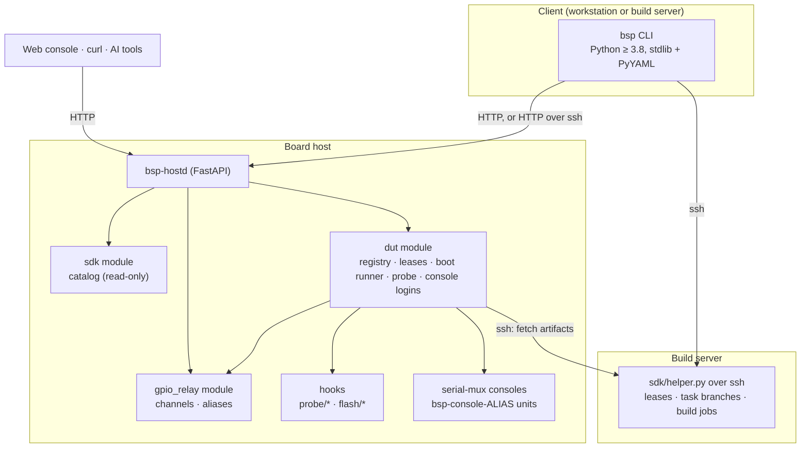
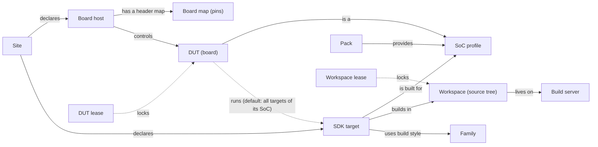
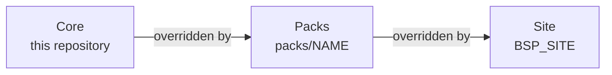

# Architecture

bsp is an atomic, scriptable layer over three kinds of resources — boards (DUTs), the board
hosts that control them, and SDK source trees on build servers. Every capability is one
command that works the same for a human at a terminal, an agent (`--json`), an HTTP client
and the web console. This page describes the internals; start with the [README](../README.md) for an overview.

## Components



Every host feature is a `Module` that publishes `CommandSpec`s; each spec becomes a REST route,
an AI tool, a web-console command and a CLI subcommand at once (`core/cmdspec.py`). SDK work
that touches source trees is client-side: the CLI pipes a stdlib-only helper to the build
server over ssh, so nothing is installed there.

## Concepts



## Configuration layers

`src/bsp/core/site.py` defines the layers, merged lowest first (later wins per file / key):

| layer | what | where |
|---|---|---|
| core | mechanism, abstract concepts, generic hooks (`hooks/`), `examples/site/` | this repo |
| packs | public hardware knowledge: SoC profiles, purchasable board pin maps, hooks for public tool formats | `packs/<name>/`, selected by `<site>/bsp.yaml` `packs:` (default: all) |
| site | private: hosts, deploy targets, build servers, SDK layouts, boot/flash recipes, probe images, DUTs, hints | `$BSP_SITE`, `~/.config/bsp/site`, `/etc/bsp/site` |



Each layer may contribute `boards/`, `socs/`, `hooks/`, `sdk/{families,servers,workspaces,instances}/`,
`duts/`, `hints/`. Consumers ask for `layered(kind)` and never hard-code a vendor. A
"distribution" (e.g. an upstream-kernel loop for one SoC family) is a further layer of the
same shape: a curated pack set plus recipe templates a site can start from.

Rule of thumb: if anyone who buys the hardware sees the same thing (boot-ROM output, header
pin map, a vendor's documented image format), it may go in a pack. If it describes *your*
machines, trees, accounts or procedures, it is site configuration.

## Resources and identities

| resource | identity | where defined | owned by |
|---|---|---|---|
| build server | id (ssh user@host, job env) | `<site>/sdk/servers/` | — |
| SDK family | how to build (make / envsetup / script) + artifact roles | `<site>/sdk/families/` | — |
| workspace | one checkout on one server — **unit of mutual exclusion** | `<site>/sdk/workspaces/` (or implicit per instance) | lease, task branch, build lock, jobs in `<path>/.bsp/` |
| SDK instance (target) | workspace + family + SoC + artifacts + boot recipes | `<site>/sdk/instances/` | via its workspace |
| SoC profile | boot-ROM fingerprint, download mode, USB ids, identify sequence, probe images | `socs/<soc>/soc.yaml` in packs / site (deep-merged) | — |
| board host | id (bsp-hostd) | `<site>/hosts/<id>.yaml`, `<site>/remotes.json` | — |
| DUT | host + SoC + control + usb + console (+ sdks; default = all SDKs of its SoC) | probed → host state, or `<site>/duts/` | lease in host state |
| reset / FDL line | alias `<dut>/reset`, `<dut>/fdl` on gpio-relay | registered by the dut module | — |
| console | serial-mux alias, run as systemd unit `bsp-console-<alias>` | serial-mux (`third_party/serial-mux`) | — |
| artifacts | sha256 | host cache `<state_dir>/dut/artifacts/<sha>/` | — |

Aliases make calls pass straight through: `bsp dut reset <dut>` → dut module → control
backend → gpio-relay `button click <dut>/reset` → header pin.

## SoC profiles

`socs/<soc>/soc.yaml` (all keys optional, deep-merged across layers):

```yaml
soc: soc-a
fingerprint: [regex, ...]            # boot-ROM console lines after a reset; probe picks the best match
download_mode: {console: regex, fastboot: regex}   # how to tell the board waits for images
usb_vids: ["xxxx"]                   # probe narrows USB enumeration to these
images: {key: {file: name, sha256: ...}}           # resolved to the highest layer holding the file
identify:
  sequence: [{stage: key, console: regex, fastboot: regex}, ...]   # stage image, continue, wait
  fields: {name: regex}              # extracted from the console after the sequence (mem_gib/mem_mb -> mem)
  placeholders: {field: [value, ...]}   # values that mean "not programmed"
  name: [field, ...]                 # joined into the name hint for the probed board
```

Probe uses `fingerprint` to name the SoC, `download_mode` to know when a reset landed in
download mode, and the generic `hooks/probe/identify` to run `identify`. Boot uses
`download_mode` when a DUT has no explicit `control.fdl.expect`.

## Design patterns / extension points

| what to change | how | interface |
|---|---|---|
| add a board host | `<site>/hosts/<id>.yaml` + `<site>/deploy/<id>.env` + `remotes.json`, `deploy/deploy.sh <id>` | host config |
| add a board (DUT) | plug it in, `bsp probe` | `dut.add` JSON spec |
| new SoC | `socs/<soc>/soc.yaml` in a pack; probe images in the site | SoC profile |
| probe mechanism | replace `hooks/probe/{consoles,usb-devices,identify}` (any language) | JSON stdin → last-line JSON stdout, exit 0/2/other |
| reset/FDL mechanism | `ControlBackend` subclass, `@CONTROL_BACKENDS.register` (gpio-relay, human, home-assistant stub) | `reset(log, ready)`, `enter_fdl(log, ready)`, `setup()` |
| boot / flash procedure | recipe steps in the SDK instance (`boot.load`, `boot.download`); a `hook` step calls `hooks/flash/<name>` | step kinds in `sdk/catalog.py` |
| new SDK | `<site>/sdk/instances/<id>.yaml` (+ family if the build style is new) | YAML |
| new build style | family `build.runner` (`make`, `envsetup`, `script`) in `Instance.build_command` | runner |
| GPIO hardware | `GpioBackend` strategy (sysfs, gpiod, mock) behind `GuardedBackend` | `set_output/set_input/status/free` |
| transport to hosts | `HttpTransport` / `SshTransport` chain per remote | `request()`, `stream()` |
| agent knowledge | `hints/*.md` in a pack or the site; `bsp hints`, `bsp install` | free text |
| new host feature | a `Module` with `CommandSpec`s → REST + CLI + AI tools + web console | `core/module.py` |

Other patterns: Registry/plugin (`core/registry.py`), Command (`core/cmdspec.py`),
Facade (services), State (channel modes), Observer (event bus → SSE), background Jobs
(`core/jobs.py`) for long operations with progress lines, Leases for shared resources.

## Shared trees: workspace vs SDK target

One source tree can build several targets (an upstream kernel tree building for two SoCs).
Exclusion must follow the tree, not the target name, so:

- a **workspace** is the tree (server + path + dev repos); its lease, task branch, build
  lock and job list live in `<path>/.bsp/`;
- an **SDK instance** is a *target* in a workspace: build command, artifacts dir, SoC and
  boot recipes. Acquiring any target leases the workspace; the same holder can then
  build/boot the other targets too, everybody else gets a conflict naming the holder, task
  and target. Instances without `workspace:` own an implicit one.

## Multi-instance model

- **many hosts**: the CLI fleet = all reachable hosts (remote mode) or just the local one
  (host mode); `dut` commands are routed to the owning host; `probe`/`dut list` fan out.
- **many DUTs per host**: every DUT has its own USB path (`fastboot -s usb:X`), serial-mux
  alias and reset alias; leases and a per-DUT busy guard serialize access.
- **many SDKs / SoCs**: each workspace has its own lease, task branch, build lock and job
  dir; different workspaces build in parallel. Boot checks SoC compatibility; probe detects
  the SoC from the boot-ROM log.
- **many users/agents**: leases (DUT and SDK) with tokens; `--stateless` + explicit tokens
  for parallel agents on one machine.

## Errors

Every failure is `{code, message, hint, details}`; `hint` is the next step (did-you-mean,
who holds a lease, which command to run), `details` carries machine-readable context
(console tail, build log tail, candidates). CLI exit codes: 0 ok, 1 failed, 2 usage, 3 unreachable.

Hardware quirks belong to the pack that knows the hardware (e.g. `packs/spacemit/README.md`).
