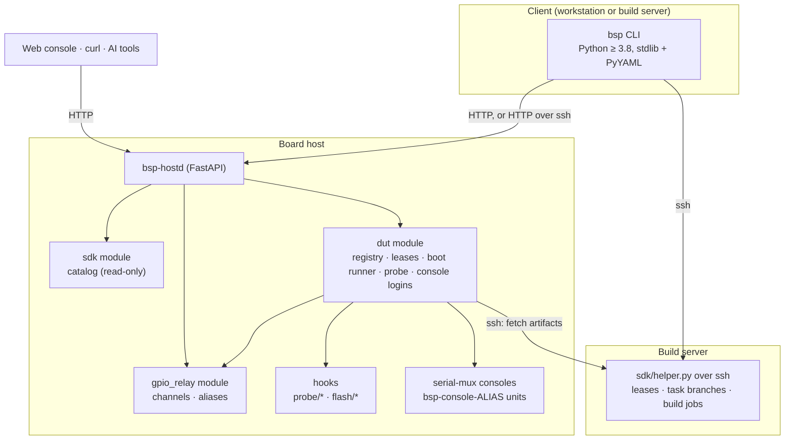
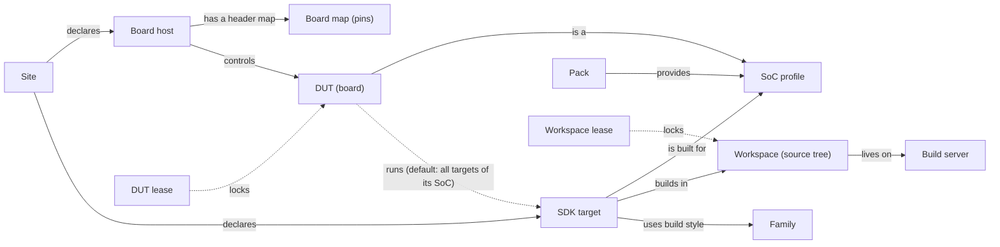
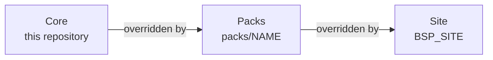

# Architecture

bsp is an atomic, scriptable layer over three kinds of resources — boards (DUTs), the board
hosts that control them, and SDK source trees on build servers. Every capability is one
command that works the same for a human at a terminal, an agent (`--json`), an HTTP client
and the web console. This page describes the internals; start with the [README](../README.md) for an overview.

## Components

Every host feature is a `Module` that publishes `CommandSpec`s; each spec becomes a REST route,
an AI tool, a web-console command and a CLI subcommand at once (`core/cmdspec.py`). SDK work
that touches source trees is client-side: the CLI pipes a stdlib-only helper to the build
server over ssh, so nothing is installed there.

## Concepts

## Configuration layers

Configuration is merged from the core, the selected packs and the site, in that order
(`src/bsp/core/site.py`). Code never refers to a vendor or an installation; it asks for the
merged view of a kind of data (`layered("socs")`, `layered("sdk")`, …). The layers and their file
formats are described in [configuration.md](configuration.md).

The same mechanism allows further layers between packs and sites — for example a curated set of
packs and recipe templates for one SoC family's upstream kernel work.

## Resources

| Resource | Identified by | Defined in | Exclusive access |
|---|---|---|---|
| Build server | id (ssh login, job environment) | `SITE/sdk/servers/` | — |
| Family | build style and artifact roles | `SITE/sdk/families/` | — |
| Workspace | one checkout on one server | `SITE/sdk/workspaces/`, or implicit per target | Workspace lease, build lock, jobs in `TREE/.bsp/` |
| SDK target | workspace + family + SoC + artifacts + boot recipes | `SITE/sdk/instances/` | Through its workspace |
| SoC profile | SoC id | `socs/<soc>/soc.yaml` in packs and the site (deep-merged) | — |
| Board host | host id | `SITE/hosts/`, `SITE/remotes.json` | — |
| DUT | DUT id: host, SoC, control backend, USB path, console | Registered on the host (`probe`, `bind`, `add`) or `SITE/duts/` | DUT lease on its host |
| Reset / download-mode line | aliases `<dut>/reset`, `<dut>/fdl` | Registered by the dut module with gpio_relay | Through the DUT |
| Console | serial-mux alias, systemd unit `bsp-console-<alias>` | serial-mux on the host | Through the DUT (writes) |
| Build artifact | SHA-256 | Host cache `STATE_DIR/dut/artifacts/` | — |

Aliases let commands pass straight through the layers: `bsp dut reset board-1` reaches the dut
module, its control backend calls `button click board-1/reset`, and gpio_relay resolves that to
a header pin.

## SoC profiles

A SoC profile tells bsp how to recognise the SoC and its download mode, and how to identify a
board during probing; [porting.md](porting.md#a-new-soc) documents every key. Probe uses
`fingerprint` to name the SoC and the generic `hooks/probe/identify` hook to run the `identify`
sequence. `enter-fdl` steps and the human reset backend use `download_mode`, unless a DUT
overrides it with `control.fdl.expect`.

## Extension points

| To add | Do this | Interface |
|---|---|---|
| A board host | `SITE/hosts/<id>.yaml`, `SITE/deploy/<id>.env`, an entry in `remotes.json`; `deploy/deploy.sh <id>` | Host configuration |
| A board | `bsp probe`, `bsp dut bind`, or a file in `SITE/duts/` | DUT spec |
| A SoC | `socs/<soc>/soc.yaml` in a pack; probe images in the site | SoC profile |
| A probe mechanism | Replace `hooks/probe/{consoles,usb-devices,identify}` | JSON hook contract |
| A reset mechanism | Subclass `ControlBackend`, register with `@CONTROL_BACKENDS.register` | `reset(log, ready)`, `enter_fdl(log, ready)`, `setup()` |
| A boot or flash procedure | Recipe steps in the SDK target; `hook` steps call `hooks/flash/<name>` | [Step reference](sdk.md#boot-recipe-steps) |
| An SDK | `SITE/sdk/instances/<id>.yaml`, plus a family for a new build style | YAML |
| A build style | A runner in `Instance.build_command` (`make`, `envsetup`, `script` exist) | Runner |
| GPIO hardware | A `GpioBackend` (sysfs, gpiod and mock exist), wrapped by `GuardedBackend` | `set_output`, `set_input`, `status`, `free` |
| A transport to hosts | A transport in the remote's chain (`HttpTransport`, `SshTransport` exist) | `request()`, `stream()` |
| Agent knowledge | `hints/*.md` in a pack or the site | Free text |
| A host feature | A `Module` that publishes `CommandSpec`s: REST, CLI, AI tools and web console follow | `core/module.py` |

Long operations (boots, probes, human-assisted resets) run as background jobs
(`core/jobs.py`) that report progress lines; changes are published on an event bus that feeds
`bsp watch` and the web console.

## Shared source trees

One source tree can build several targets, such as an upstream kernel tree built for two SoCs.
Mutual exclusion therefore follows the tree, not the target: a **workspace** is the tree, and its
lease, task branch, build lock and job list live in `TREE/.bsp/`. An **SDK target** is a build
configuration within a workspace. Acquiring any target leases the whole workspace; the holder can
then build and boot every target in it, and everyone else gets a conflict naming the holder,
task and target. A target without `workspace:` owns an implicit workspace.

## Concurrency

- **Hosts.** The CLI talks to every reachable host, or only to the local one when it runs on a
  board host. Board commands are routed to the host that owns the board; `probe` and `dut list`
  query all hosts in parallel.
- **Boards.** Each board has its own USB path, console and reset alias. Leases and a per-board
  busy guard serialise access.
- **SDKs.** Each workspace has its own lease, branch, build lock and jobs, so different
  workspaces build in parallel. Boot refuses SDK targets built for a different SoC.
- **People and agents.** DUT and workspace leases carry tokens; `--stateless` with explicit
  tokens lets several agents share one machine and user account.

## Errors

Every failure has a `code`, a `message`, a `hint` naming the next step, and machine-readable
`details`; see [cli.md](cli.md#output-and-errors). Hardware quirks are documented by the pack
that knows the hardware (for example `packs/spacemit/README.md`).
