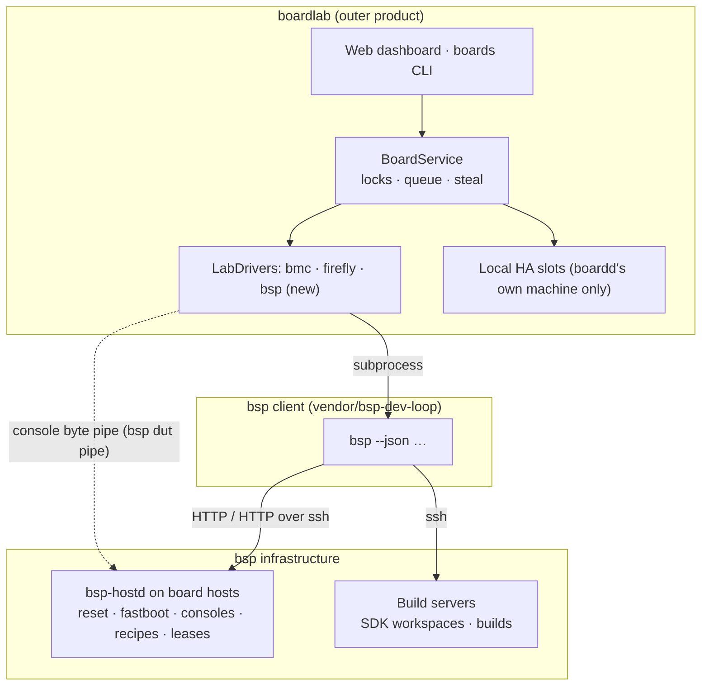

# Integration guide: boardlab on top of bsp

Working document for the integration branch `dist/bsp-cli-intergration`. It is written for an
engineer or agent who takes over with no other context. A follow-up agent will restructure it
into proper docs; until then this single file is the source of truth for the plan.

> Private pointers (the boardlab repository URL, the hosts and boards used for hardware
> acceptance) are deliberately **not** in this file: this repository is open source. They live in
> the private site repository, `SITE/notes/boardlab.md` (on the original workstation:
> `~/.config/bsp/site/notes/boardlab.md`).

---

## 1. Goal and decision

**boardlab** is a board-lab manager (TypeScript, MIT): the `boardd` daemon, the `boards` CLI, a
web dashboard, people-friendly locks with a queue, and remote-lab drivers. **bsp** (this
repository) is the infrastructure: board hosts, consoles, fastboot, reset control, boot recipes,
SDK workspaces and builds on build servers, a multi-host CLI and HTTP API.

Decision (owner's preference, confirmed by the code review below):

- **boardlab is the outer product; bsp is infrastructure it calls.**
- boardlab references bsp as a **git submodule** (`vendor/bsp-dev-loop`, pinned to a tag or
  commit). bsp never depends on boardlab.
- The coupling is **only** bsp's public interfaces — the `bsp` CLI with `--json`, and the
  `bsp-hostd` HTTP API. boardlab never imports bsp source files (different languages) and never
  reads bsp state files.
- The seam inside boardlab is its existing **`LabDriver`** interface: bsp becomes one more
  "remote lab" (kind `bsp`). This keeps boardlab changes small and additive, so they can be
  offered upstream to boardlab's author.

Rejected alternative: bsp embedding boardlab (Node inside `bsp-hostd`, two lock systems in one
process, two languages in one service).

---

## 2. What each side is (facts from the code)

### 2.1 boardlab

| Path | What |
|---|---|
| `src/server/service.ts` | `BoardService`: inventory, leases, queue, steal, reset/fastboot, console, stage/boot, scans, labs. All hardware actions go through a held lease |
| `src/server/labs.ts` | `LabDriver` interface, `sshShell` (ssh/scp with ControlMaster, `ssh -W` TCP), `jumpStage` (copy by sha256 to a jump host, `fastboot stage`+`continue`), `jumpPresent` |
| `src/server/bmc.ts`, `src/server/firefly.ts` | Two lab drivers (a BMC cluster manager; a rack aBMC) — reference implementations for the new driver |
| `src/server/serial-mux.ts` | Native serial-mux client: length-prefixed JSON over the daemon's Unix socket; `MuxSession` (hello, history, send, onOutput, onClose); input-gate set/clear |
| `src/server/ha.ts`, `hardware.ts`, `scan.ts` | Local hardware: Home Assistant slots, sysfs USB/tty discovery, fastboot, slot scripts, the one-click scan |
| `src/server/http.ts` | Routes `GET/POST /api/...`; Unix socket for the CLI (holder header `x-boards-holder`), loopback HTTP for the page (Host-header and cross-site checks, no token) |
| `src/server/main.ts` | `startBoardd`: wires HA, serial-mux, hardware and the labs map `{ bs01dcma, tq }`; lab sync every 60 s |
| `src/shared/types.ts`, `client.ts` | Wire types and the typed client |
| `src/cli/main.ts` | `boards` CLI (Chinese UI text) |
| `skills/boards/` | Claude skill (`SKILL.md`, `boot.md`) and K3 FIT helper scripts |
| `firmware/` | `firmware.json` registry + K3 images (`fsbl`, `u-boot-opensbi`, `minor-board-info`) |
| `tests/boardd.spec.ts` | ~60 vitest cases with fake hardware |
| `AGENTS.md` | Repository rules (see §3) |

Runtime: Node ≥ 24 (`node:sqlite`), pnpm, esbuild. State in `~/.local/state/troy-boards`
(SQLite, socket, ssh control sockets).

The `LabDriver` contract (`src/server/labs.ts`):

```ts
interface LabDriver {
  kind: string
  defaultJump(url: URL): string
  verify(config: LabConfig): Promise<string>
  devices(config: LabConfig): Promise<LabDevice[]>
  reset(config: LabConfig, device: string): Promise<void>
  fastboot(config: LabConfig, device: string): Promise<string | void>   // may return the download port
  console(config: LabConfig, device: string, options?: { history?: boolean }): Promise<MuxSession>
  stage(config: LabConfig, usbPath: string, file: { path: string, sha256: string }, timeoutMs?: number): Promise<string>
  present(config: LabConfig, usbPath: string): Promise<boolean>
}
interface LabConfig { url: string, username: string, password: string, jump: string }
interface LabDevice { name, model, online, serialPort, serialConnected, downloadUsbPath, ip }
```

Lab boards are registered as `<lab>-<device>`, never scanned, never exported, and are refreshed
every minute. `BoardService.boot()` stages files in order and between files waits for the
download port to come back (`portBack`: 8 s after the first file, 3 s after later ones, then
polls `present()` for up to 20 s).

### 2.2 bsp

See `README.md` and `docs/`. The parts the integration uses:

| Need | bsp today |
|---|---|
| List boards across hosts | `bsp --json dut list` (fleet over HTTP or ssh tunnels, from `SITE/remotes.json`) |
| Lease | `bsp --json [--stateless] dut acquire DUT --holder H --purpose P --ttl S` → `{token, expires_in_s, ...}`; max TTL 24 h; `dut release DUT --lease T` |
| Reset / download mode | `bsp --json dut reset DUT --lease T [--no-fdl]`; human-reset boards return `{job, needs_human: true}` |
| Jobs | `bsp --json job get JOB -r HOST --wait S` |
| Console (command) | `bsp --json dut console DUT "CMD" --lease T` |
| Console (passive) | `bsp --json dut log DUT --lines N` |
| Console (stream) | **missing** — interactive attach exists only as `ssh -t HOST smtty ALIAS` |
| Stage an arbitrary file | **missing** — recipes pull artifacts from build servers by role |
| SDK boot | `bsp dut boot DUT --sdk SDK [--method load\|download]` |
| SDK work | `bsp sdk acquire/build/exec/get/put/release` |

`bsp --json dut list` returns one object per board (real output from the mock host):

```json
{"id": "mock-board", "host": "dev-mock", "board": "board-x", "soc": "soc-b",
 "description": "...", "usb": "usb:0-0", "console": "mock-board",
 "control": "gpio-relay", "fdl": "strapped", "sdks": ["upstream-a"], "sdks_explicit": false,
 "origin": "catalog", "lease": null, "busy": null, "fastboot": null, "stage": "off-bus",
 "needs_human": null, "control_state": {"backend": "gpio-relay", "...": "..."},
 "console_attach": "smtty mock-board", "console_tail": ["..."]}
```

- `lease` is `{holder, purpose, expires_in_s}` or null.
- `stage` is `off-bus`, `download-mode`, `fastboot`, `os?` or `needs-human`.
- `needs_human` is `{action, message, waiting_s}` while a person is asked to act.

Every command prints `{"ok": true, "result": …}` or
`{"ok": false, "error": {"code", "message", "hint", "details"}}`. Exit codes: 0 ok, 1 failed,
2 usage or ambiguous host, 3 unreachable.

Human reset flow (real output):

```text
$ bsp --json dut reset slot-1 --lease T --no-wait
{"ok": true, "result": {"dut": "slot-1", "fdl": true, "job": "reset-…-1", "needs_human": true, "host": "lab-1"}}
$ bsp --json dut confirm slot-1
{"ok": true, "result": {"dut": "slot-1", "confirmed": "enter download mode", "waited_s": 4.2}}
```

---

## 3. Rules that bind the work

### boardlab repository (from its `AGENTS.md`)

- Work only on a dedicated branch (here `dist/bsp-cli-intergration`), never on `main`.
- Before merging, rewrite the branch into clean commits by functional module, each complete and
  working on its own.
- Every commit is **OpenPGP-signed** with the owner's key; verify with `git verify-commit`. If
  signing is not possible, stop and report it — do not commit unsigned. (No signing key was
  configured on the original workstation; set one up first.)
- The only trailer allowed is the owner's own `Signed-off-by`. **No AI attribution trailers**
  (no `Co-Authored-By`).
- Plans and notes go under `internal/` (git-ignored). `README.md` and `skills/` are public: no
  personal information, private addresses or credentials.
- `AGENTS.md` stays in English. Tests use fake hardware only.
- Validate with `pnpm install && pnpm run typecheck && pnpm run build && pnpm test`.

### bsp repository (this one)

- Open source: mechanism only. No host names, addresses, accounts, internal URLs or SDK paths;
  those go in the site. Use `192.0.2.0/24` and made-up names in examples and tests.
- Tests run without hardware (`.venv/bin/pytest`, against `examples/site/`).
- Every user-facing change updates `docs/` and `CHANGELOG.md`. Docs must read like a polished
  open-source project (see `CONTRIBUTING.md`).
- The client must keep working from a clone on Python 3.8 (`bin/bsp`, stdlib + PyYAML); the host
  side needs Python ≥ 3.10.

### Hardware safety (both)

- **Never run boardd's local-hardware mode (HA slots, scan) on a bsp board host.** A boardlab
  scan stops every serial-mux daemon and restarts them under its own names; that breaks bsp's
  `bsp-console-<alias>` units, its console logins and its leases. boardd reaches bsp boards only
  through the `bsp` lab driver.
- One source of truth per board: for bsp boards it is the **bsp lease**. boardlab's lock on a bsp
  board must hold the matching bsp lease (§6).
- Take a lease before reset, download mode, boot or console input; release afterwards.

---

## 4. Target architecture



Responsibilities after phases 1–2:

| Concern | Owner |
|---|---|
| Physical control of boards on bsp hosts, consoles, fastboot, recipes | bsp |
| SDK trees, builds, artifacts | bsp |
| Lease truth for bsp boards | bsp |
| Dashboard, queue and steal UX, notifications | boardlab |
| BMC / aBMC labs, boardd-local HA boards | boardlab (until phase 3) |
| Agent skill for SDK work | bsp (`skills/bsp-dev-loop`) |
| Agent skill for the lab dashboard and queue | boardlab (`skills/boards`) |

---

## 5. Work items in bsp (this repository)

All of them are generic features, useful without boardlab, and must be documented in `docs/cli.md`,
`docs/configuration.md` or `docs/sdk.md` as appropriate.

### B1. Console byte pipe: `bsp dut pipe DUT`

Purpose: give programs a raw, bidirectional connection to the board's serial-mux daemon, speaking
serial-mux's own protocol. boardlab already has a complete client for that protocol
(`src/server/serial-mux.ts`), so it needs nothing else.

- CLI: `bsp dut pipe DUT` connects stdin/stdout to the host's serial-mux socket for the DUT's
  console alias and exits when either side closes. No lease is needed (serial-mux's input gate
  controls input, see B5); reading is allowed for everyone, as with `dut log`.
- Host side: the socket path is `<serial_log_dir>/../run/<alias>.sock` (see
  `src/bsp/dut/consoles.py`, `ConsoleManager.run_dir`). Expose it in `dut.status` as
  `console_socket` next to `console_attach`.
- Transport: over the remote's `ssh` target, run a stdlib Python bridge on the host
  (`python3 -c 'import socket,sys,…'`; the host always has Python ≥ 3.10) — no socat dependency.
  When bsp runs on the host itself (local mode), connect to the socket directly.
- Implement in `src/bsp/cli/dutcli.py` (new action) using the remote's ssh target the way
  `_attach` does; reject with a clear `hint` when the remote has no `ssh` entry.
- Tests: a fake socket server and a local-mode pipe round trip.

### B2. Stage arbitrary files: artifact upload, `dut.stage`, `dut.present`

Purpose: `LabDriver.stage/present` and boardlab's ordered `boards boot` of local files.

- `PUT /api/v1/artifacts/<sha256>` (body = file bytes, token-protected like other writes): store
  into the existing cache `STATE_DIR/dut/artifacts/<sha256>/` (`ArtifactStore`,
  `src/bsp/dut/hostio.py`) after verifying the checksum; `HEAD` the same URL to test presence, so
  unchanged files are never sent twice.
- Host command `dut.stage {dut, sha256, lease, continue=true, timeout}`: `fastboot -s USB stage`
  + `continue` on the DUT's USB path, under the lease and the per-DUT busy guard.
- Host command `dut.present {dut}`: whether the DUT's download/fastboot device is enumerated
  (reuse `FastbootCli.state()`).
- CLI: `bsp dut stage DUT FILE [--no-continue]` (computes sha256, uploads if missing, stages) and
  `bsp dut present DUT`.
- Over ssh-only remotes the upload must also work: the ssh transport already pipes request bodies
  to `curl --data-binary @-` on the host (`src/bsp/cli/transport.py`); check that it streams
  bodies of ~100 MB (kernel FITs) without loading them into memory twice, and send them as
  `application/octet-stream`.

### B3. Ordered file boot: `bsp dut boot DUT --files F1 F2 F3`

Purpose: boardlab's `boards boot` semantics inside bsp, so both CLIs behave the same and boardlab
can delegate the whole sequence in one call.

- Builds an ad-hoc recipe: `enter-fdl` (unless `--no-reset`), then per file `stage` + `continue`
  + wait for the download port to return (first wait 8 s, later 3 s, then poll up to 20 s —
  boardlab's proven timings; make them options).
- Runs as a background job like `dut boot --sdk`, with the same progress lines and exit codes.
- Files go through B2's upload; record path and sha256 of each in the job log.

### B4. Long-held leases

boardlab locks have no time limit; bsp leases expire (default 1 h, max 24 h).

- Renewal already works: `bsp dut acquire DUT --lease T --holder H --ttl S` with the current
  token extends the lease and keeps the token (`LeaseManager.acquire`, `src/bsp/dut/leases.py`).
  The driver calls it from boardlab's 60 s lab sync.
- Optional: add `bsp dut renew DUT --lease T [--ttl S]` as an explicit alias for readability.
- Document in `docs/cli.md`.

### B5. Optional: serial-mux input gate bound to bsp leases

boardlab turns serial-mux's input gate on with a per-lease token when a lock is taken (see its
README, "串口闸门", and `SerialMux.gate`). bsp should do the same for its own leases so both
systems agree on who may type:

- On `dut.acquire`, set the gate (`gate_set` with a random token, note = holder); on release or
  expiry, clear it (`gate_clear`). Return the gate token to the lease holder only.
- bsp's own console commands (`dut.console`, console logins) pass the token
  (`smtty --token` / `SERIAL_MUX_TOKEN`).
- Requires a serial-mux with the `input-gate` capability; the bundled fork has it.

---

## 6. Work items in boardlab (other repository, branch `dist/bsp-cli-intergration`)

Keep these additive so they can be proposed upstream.

### L1. Submodule and install

- `git submodule add <bsp repository> vendor/bsp-dev-loop`, pinned to a released tag.
- The install docs and any install script: put `vendor/bsp-dev-loop/bin/bsp` on boardd's `PATH`
  (or configure its path in the lab settings), require Python ≥ 3.8 + PyYAML, and install the bsp
  site at `~/.config/bsp/site` (or set `BSP_SITE`) for the user boardd runs as.
- The bsp skills are installed with `vendor/bsp-dev-loop/deploy/install-skills.sh`.

### L2. `src/server/bsp.ts` — the `bsp` LabDriver

Run the bsp client as a subprocess (`execFile`) with `--json --stateless`, holder
`boardlab:<holder>` and the lease token passed explicitly; parse the envelope; map
`ok: false` to `BoardError('hardware', message + hint)`.

| LabDriver | Implementation |
|---|---|
| `kind` | `'bsp'` |
| `defaultJump` | unused (return `''`); bsp handles its own transports |
| `verify` | `bsp --json hosts` → "N hosts, M boards"; fail if none reachable |
| `devices` | `bsp --json dut list` → `LabDevice{ name: id, model: board, online: stage === 'os?', serialPort: console, serialConnected: true when a console daemon is up (add `console_up` to `dut status` in bsp if needed), downloadUsbPath: usb without the `usb:` prefix, ip: null }`; also carry `lease` and `needs_human` (see L3) |
| `reset` | `bsp dut reset DUT --no-fdl --lease T`; if the result has `job`, follow it with `bsp job get … --wait` until it ends |
| `fastboot` | `bsp dut reset DUT --lease T` (download mode); same job handling; return the USB path |
| `console` | spawn `bsp dut pipe DUT` (B1), wrap stdin/stdout as a Duplex and hand it to the existing serial-mux client (the Firefly driver shows how a Duplex from a child process is used) |
| `stage` | `bsp dut stage DUT FILE` (B2); the driver needs the DUT id, so keep a map usbPath → DUT from the last `devices()` |
| `present` | `bsp dut present DUT` |

Lab configuration (`LabConfig`): `url` = bsp remote selector or empty for "all hosts of the
site", `password` = bsp API token (passed as `BSP_TOKEN`), `username` unused, `jump` unused.
Register it in `src/server/main.ts`: `labs: { bs01dcma, tq, bsp: bspLab() }`.

Boards appear as `bsp-<dut>`.

### L3. Lock ↔ lease hooks in `BoardService`

`LabDriver` has no lock hooks today. Add optional methods and call them from `lock`, `unlock`,
`steal` and queue handover:

```ts
lock?(config: LabConfig, device: string, holder: string, purpose: string): Promise<{ token: string }>
unlock?(config: LabConfig, device: string, token: string): Promise<void>
```

- On lock: acquire the bsp lease (`--holder boardlab:<holder>`, long TTL) and store its token
  with the boardlab lease (new column, never returned by the API).
- Renew in the 60 s lab sync loop (B4).
- On unlock, handover or steal: the boardlab-side holder changes but the bsp lease stays with
  boardd. On handover and steal keep the same bsp lease (boardd remains the bsp holder); release
  it only when the board has no boardlab holder left.
- If `devices()` reports a bsp lease **not** held by boardd (someone uses bsp directly), show the
  board as busy ("held in bsp by X") and refuse the lock with a clear message; queueing stays
  allowed and is granted when the lease disappears.
- `needs_human` from bsp is shown on the board card ("press RESET on …"), with a button that runs
  `bsp dut confirm`; add `POST /api/confirm` and `boards confirm <board>` for agents.
- On boardd start, reconcile: for each held boardlab lock on a bsp board, renew or re-acquire.

### L4. Boot delegation

- `boards boot bsp-<dut> F1 F2 …`: delegate to `bsp dut boot DUT --files …` (B3) in one call
  instead of staging file by file, so bsp's busy guard and logs cover the whole sequence.
- Optional: `boards boot bsp-<dut> --sdk SDK` → `bsp dut boot DUT --sdk SDK`.

### L5. Skills and docs

- `skills/boards/SKILL.md`: bsp boards are listed as lab `bsp`; for SDK work (lease a tree,
  build, edit remotely) use the `bsp` CLI and its skill; on boards needing a person, run reset or
  boot in the background and confirm when the user says so.
- Keep installation-specific details out of public files (boardlab's `boot.md` already contains
  some; do not copy any of them into bsp).

### L6. Tests

- Unit: a fake `bsp` executable (shell script printing canned JSON envelopes) on `PATH`; cover
  devices mapping, reset with and without jobs, lock/renew/unlock, external-lease refusal, stage
  mapping, error envelopes.
- Contract: start the bsp mock host from the submodule and run the driver against it:

  ```sh
  python3 -m venv .bspvenv && .bspvenv/bin/pip install -e 'vendor/bsp-dev-loop[server]'
  BSP_SITE=vendor/bsp-dev-loop/examples/site .bspvenv/bin/bsp-hostd \
      -c vendor/bsp-dev-loop/examples/site/hosts/dev-mock.yaml --port 8799 &
  BSP_URL=http://127.0.0.1:8799 pnpm test -- bsp
  ```

  The mock host has `mock-board` (GPIO reset; `reset --no-fdl` works, download mode does not)
  and `mock-slot` (human reset; `confirm` works).

---

## 7. Milestones and acceptance

| Milestone | Done when |
|---|---|
| M1 bsp APIs | B1–B3 merged with tests and docs (B4 needs no code); `bsp dut pipe`, `stage`, `present`, `boot --files` work against the mock host and one real board |
| M2 driver read-only | boardlab lists bsp boards with live state; console view streams through `bsp dut pipe` |
| M3 control | lock ↔ lease hooks; reset, fastboot, stage, boot of local files on a real bsp board from the boardlab page and `boards` CLI; human-reset board confirmed from the page |
| M4 agents | a fresh agent with both skills leases a bsp board through boardlab, boots a kernel built with `bsp sdk build`, proves it in the console log and releases everything (adapt `e2e-material/` in bsp) |
| M5 (optional) B5 | serial-mux input gate follows bsp leases; boardlab's gate display works for bsp boards |

Hardware acceptance uses the boards listed in `SITE/notes/boardlab.md`; take a lease, never run
a boardlab scan against a bsp host.

---

## 8. Phase 3 backlog (deduplication, decide after M4)

Features boardlab has that bsp could absorb, after which boardd would no longer touch local
hardware and become a pure front end:

| boardlab feature | bsp target |
|---|---|
| Home Assistant slots (`ha.ts`; entity naming `board_N_reset` / `board_N_fastboot_mode`; never resend once a connection was made) | `HomeAssistantControl` in `src/bsp/dut/control.py` (currently a stub) |
| Script slots (smart plugs; 2 min timeout, process group kill) | a `script` control backend |
| FIFO queue with automatic handover, steal with reason (humans only), unlimited locks | `src/bsp/dut/leases.py` |
| Multi-chip boards (one lock, several consoles and download ports) | a die concept in the DUT spec |
| Serial-mux input gate tied to locks | B5 |
| BMC and aBMC lab drivers | a bsp "lab host" kind that adapts a vendor API instead of local hardware |
| Scan by fastboot button + board-model image | `bsp probe` with an HA/script backend; the K3 board-model image only after its provenance and license are clear (it was built from a modified tree and is marked not boot-tested) |

---

## 9. Open decisions (defaults in bold)

1. Where boardd runs (needs Node ≥ 24): **the developer workstation**, not a bsp board host.
2. Scope: **phases 1–2 (M1–M4) now**; phase 3 later.
3. Upstream: **keep boardlab changes additive and offer them to its author**.
4. Signing for boardlab commits: the owner's OpenPGP key must be configured on the machine doing
   the work; without it, stop before committing (boardlab rule).

## 10. State at hand-over

- bsp `main` contains everything described in §2.2; the hosts run it.
- The serial-mux submodule tracks the fork branch `bsp/usb-port-reconnect` (includes upstream's
  input-gate support).
- boardlab was only inspected; its repository was not modified.
